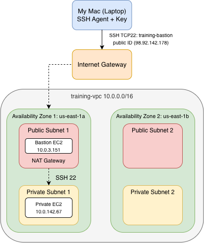

# IDX Exchange AWS Cloud Engineering Internship

This repository documents my learning and hands-on labs during the
IDX Exchange AWS Cloud Engineering Internship.

---

## Week 01 — Cloud Fundamentals & Account Setup

The AWS root user is the original account identity and has full access to all AWS services, resources, billing, and account settings. Because it has the highest level of access, it should only be used when necessary and should be protected with MFA. IAM (Identity and Access Management) is an AWS service that controls who can access AWS and what they are allowed to do. Instead of using the root user for everyday tasks, I can use IAM users with appropriate permissions. The Shared Responsibility Model explains how security responsibilities are divided between AWS and the customer. AWS is responsible for securing the physical infrastructure and services that run the cloud, while the customer is responsible for securing their accounts, access, data, and AWS resources.

---

## Week 02 — IAM & Security Foundations

## S3 Uploader Policy

**Policy:** `S3UploaderOnly-pintzu`

**Policy file:** `week-02/policies/pintzu-aws-policies.json`

This policy allows `s3:PutObject` and `s3:GetObject` for objects in `my-training-bucket-pintzu`.

This policy only gives the test user access to one specific S3 bucket. The user can upload and retrieve objects, but does not have full S3 access. This follows the principle of least privilege.

I tested the policy using the `s3test` AWS CLI profile. Running `aws s3 ls --profile s3test` returned `AccessDenied` because the test user does not have permission to list all S3 buckets.

## IAM Access Analyzer

I created an IAM Access Analyzer to monitor AWS resources for external access. The analyzer showed 0 active findings.

---

## Week 03 — EC2 Deployment and EBS Snapshot

This week, I deployed the PropertyLite Flask API to an Amazon EC2 instance using a bootstrap script in EC2 User Data.

I configured SSH access on port 22, opened port 8080 for the PropertyLite API, connected to the instance using SSH, and verified the API from my local laptop using `curl`.

I also practiced troubleshooting an SSH timeout caused by an outdated `My IP` Security Group rule.

After the deployment was working, I created an EBS snapshot of the instance's root volume and completed the required cleanup by terminating the EC2 instance and confirming that the root EBS volume was deleted.

### Key Tasks
- Launched and configured an Amazon Linux EC2 instance
- Used User Data to automatically deploy PropertyLite
- Configured Security Group rules for ports 22 and 8080
- Connected to EC2 using SSH
- Verified PropertyLite from my laptop
- Troubleshot an SSH timeout
- Created an EBS snapshot
- Cleaned up the EC2 instance and root volume

## Week 04 — Storage & Databases

This week, I learned about AWS storage and database services, including S3, EBS, EFS, RDS, and DynamoDB. I also learned about S3 storage classes, lifecycle rules, RDS Multi-AZ, and DynamoDB partition keys and capacity modes.

**What I Did:**

- **Amazon S3:** Created an S3 bucket, uploaded my Week 3 runbook, and configured a lifecycle rule to move files to Glacier Flexible Retrieval after 30 days.
- **Amazon RDS:** Created a MySQL database and connected to it through an EC2 instance in the same VPC. Imported 55,212 property records, removed 17 sensitive columns, and checked the listing IDs. I also used SQL to calculate property counts and average prices by city.
- **Amazon DynamoDB:** Created a `Properties` table using AWS CLI, set `L_ListingID` as the partition key, and used `put-item` and `get-item` to add and retrieve a record.
- **Cleanup:** Deleted the DynamoDB table, terminated the EC2 instance, and initiated deletion of the RDS database to avoid unnecessary AWS charges.


I learned that different AWS services are used for different types of data. S3 is useful for storing files, EBS works like a hard drive for EC2, and EFS lets multiple servers share files. RDS is useful for structured data and SQL queries, while DynamoDB is useful for fast lookups using keys.

**Deliverable:**
- [Week 04 — Storage & Database Decision Guide](week-04/decision-guide.md)

## Week 05 — VPC Networking

This week, I learned how AWS networking works by creating a custom VPC and connecting to a private EC2 instance through a bastion host.

### Lab 5.1 — Create a Custom VPC

I created a VPC using the AWS Console with the following settings:

- VPC name: `training-vpc`
- IPv4 CIDR: `10.0.0.0/16`
- Availability Zones: 2
- Public subnets: 2
- Private subnets: 2
- NAT Gateway: 1

This helped me understand the difference between public and private subnets and how AWS manages network traffic.

### Lab 5.2 — Bastion Host

I launched two EC2 instances:

- `training-bastion` in a public subnet
- `training-private` in a private subnet

The bastion host had a public IP address and allowed SSH access from my IP.

The private instance had no public IP address. Its security group allowed SSH only from the bastion host's security group.

#### SSH Connection

First, I connected to the bastion host from my Mac:

```bash
ssh -A -i ~/.ssh/training-key.pem ec2-user@98.92.142.178
```

Then, from the bastion host, I connected to the private instance:

```bash
ssh ec2-user@10.0.142.67
```

At first, I got a `Permission denied (publickey)` error.

I fixed this by adding my SSH key to the SSH agent on my Mac using `ssh-add`.

After that, I successfully connected to the private instance through the bastion host.

### Lab 5.3 — Network Debugging

I ran the following command on the private instance:

```bash
sudo yum update -y
```

The command completed successfully and showed `Nothing to do` and `Complete!`.

This showed that the instance could access the package repositories even without a public IP address.

### Traffic Path

My Mac connects to the bastion host using its public IP address through SSH.

The bastion host then connects to the private EC2 instance using its private IP address.

This setup allows me to manage the private instance without exposing it directly to the internet.

### VPC Diagram




## Week 06 — Load Balancing & Auto Scaling

This week, I focus on how to use an Application Load Balancer (ALB) and an Auto Scaling Group (ASG) to manage EC2 instances running the PropertyLite Flask API.

### Lab 6.1 — Application Load Balancer & Auto Scaling Group

#### 1. Created a Launch Template

I created a Launch Template called `property-api-template` with the following settings:

- **AMI:** Amazon Linux 2023
- **Instance Type:** t3.micro
- **Security Group:** default
- **User Data:** Installed Python and Flask and started the PropertyLite API on port 8080.

The Launch Template allows AWS to launch new EC2 instances using the same settings.

#### 2. Created a Target Group

I created a Target Group to connect the EC2 instances to the ALB.

- **Target Type:** Instances
- **Protocol:** HTTP
- **Port:** 8080
- **Health Check Path:** `/health`

The health check helps AWS determine whether the Flask API is running correctly.

#### 3. Created an Application Load Balancer

I created an internet-facing ALB named `training-alb` across two public subnets.

The ALB receives HTTP requests on port 80 and forwards them to the EC2 instances through the Target Group.

#### 4. Created an Auto Scaling Group

I created an ASG named `training-asg` across two private subnets in different Availability Zones.

- **Desired Capacity:** 2
- **Minimum Capacity:** 1
- **Maximum Capacity:** 4
- **Scaling Policy:** Target Tracking — Average CPU Utilization 50%

The ASG automatically manages the number of EC2 instances based on the scaling policy.

#### 5. Tested the ALB

After fixing the initial deployment issue, both EC2 instances became Healthy.

I tested the ALB using:

```bash
curl http://training-alb-909055074.us-east-1.elb.amazonaws.com/health
curl http://training-alb-909055074.us-east-1.elb.amazonaws.com/properties
```

The `/health` endpoint returned:

```json
{"status":"ok"}
```

The `/properties` endpoint successfully returned sample property data.

### Lab 6.2 — Self-Healing & CPU Stress Test

#### Part A — Self-Healing

I manually terminated an EC2 instance to test the ASG's self-healing behavior.

I observed the replacement process through the ASG Activity History.

#### Part B — CPU Stress Test

I installed `stress` on an EC2 instance and ran:

```bash
sudo dnf install -y stress
stress --cpu 2 --timeout 300
```

CloudWatch showed CPU utilization increasing to **57.01%**.

I also observed automatic Scale In when CPU usage was low. However, automatic CPU-triggered Scale Out was not observed during the test.

For more details, see [Load Test Report](load-test-report.md).

### Debug Lab 6.3 — ALB Returns 502 Bad Gateway

#### Problem

The ALB returned a `502 Bad Gateway` error, and both EC2 instances were Unhealthy.

#### Troubleshooting

1. Checked the Target Group health status and Security Group rules.
2. Checked the EC2 System Log and found `Failed to run module scripts-user`.
3. Found and removed an extra blank line before `#!/bin/bash` in the User Data.
4. Created Launch Template again.

#### Result

After launch template created again, both EC2 instances became Healthy, and the ALB successfully returned responses from `/health` and `/properties`.

#### Key Takeaways
- **ALB:** Distributes incoming HTTP requests to healthy EC2 instances.
- **Target Group:** Connects the ALB to backend EC2 instances and performs health checks.
- **ASG:** Automatically manages EC2 capacity.
- **Self-Healing:** Replaces terminated or unhealthy instances.
- **Scale Out:** Adds EC2 instances when more capacity is needed.
- **Scale In:** Removes EC2 instances when less capacity is needed.
- **CloudWatch:** Monitors CPU utilization and scaling activities.

## Week 07 — Serverless & Event-Driven Architecture

### Objective

This week, I focus on how to build a serverless API using AWS Lambda, API Gateway, and DynamoDB. I also learned how Amazon SQS and Dead-Letter Queues (DLQs) work.

### Lab 7.1 — API Gateway, Lambda, and DynamoDB

#### 1. DynamoDB Setup

I created a DynamoDB table named `Properties` with `L_ListingID` as the partition key and `PAY_PER_REQUEST` billing mode.

I added a sample property record (`R100234`) and used `get-item` to verify that the data could be retrieved.

#### 2. Lambda Function

I created a Lambda function named `get-property` using Python 3.12.

The function uses Boto3 to look up property data from DynamoDB based on the listing ID received from API Gateway.

#### 3. IAM Permissions

I created a custom IAM policy that allows the Lambda function to perform `dynamodb:GetItem` only on the `Properties` table.

(This follows the least-privilege principle from Week 2.)

#### 4. API Gateway

I created an HTTP API named `propertylite-api` and connected it to the Lambda function.

- Method: `GET`
- Route: `/properties/{id}`
- Integration: Lambda `get-property`

#### 5. Request Path Diagram

```text
Request:
Client (Mac Terminal)
       |
       | GET /properties/R100234
       v
API Gateway (HTTP API)
       |
       v
AWS Lambda (get-property)
       |
       | DynamoDB GetItem
       v
DynamoDB (Properties)

Response:
DynamoDB → Lambda → API Gateway → Client (Mac Terminal)
                      |
                      v
                 JSON Response
```

When I send a GET request, API Gateway calls the Lambda function. Lambda then gets the property data from DynamoDB and returns it as JSON.

#### 6. API Testing

I used curl to test the API:

```bash
curl -i "https://k694kuq6ej.execute-api.us-east-1.amazonaws.com/properties/R100234"
```

The API successfully returned the property data in JSON format.

### Lab 7.2 — SQS with a Dead-Letter Queue

I created two SQS queues:

- `property-queue`: Stores property messages.
- `property-dlq`: Stores messages that repeatedly fail to be processed.

#### 1. Create the Queues

First, I created the Dead-Letter Queue:

```bash
aws sqs create-queue --queue-name property-dlq
```

Then, I created `property-queue` and set up a RedrivePolicy with `maxReceiveCount` set to 3.

```bash
aws sqs create-queue \
  --queue-name property-queue \
  --attributes '{"RedrivePolicy":"{\"deadLetterTargetArn\":\"arn:aws:sqs:us-east-1:629690103267:property-dlq\",\"maxReceiveCount\":\"3\"}"}'
```

#### 2. Send Message

I used AWS CLI to send a test message to `property-queue`.

```bash
aws sqs send-message \
  --queue-url https://sqs.us-east-1.amazonaws.com/629690103267/property-queue \
  --message-body '{"PropertyId":"P1002"}'
```

The command returned a MessageId, showing that the message was successfully sent to SQS.

#### 3. Receive Message

Then, I used `receive-message` to get the same message from the queue.

```bash
aws sqs receive-message \
  --queue-url https://sqs.us-east-1.amazonaws.com/629690103267/property-queue
```

The response included:

```json
{
  "MessageId": "316c2600-47a7-4139-b3c2-babeaee77488",
  "Body": "{\"PropertyId\":\"P1002\"}"
}
```

I successfully sent and received the same message using Amazon SQS.


### Debug Lab 7.3 — API Gateway 500 Internal Server Error

**Issue:** When I tested the API, I got a 500 Internal Server Error.

**Root Cause:** I checked CloudWatch Logs and found that Python couldn't convert the Decimal values from DynamoDB into JSON (TypeError: Object of type Decimal is not JSON serializable).

**Fix:** I updated the Lambda code to convert Decimal values into integers or floats before returning the response.

I added the following import:

```python
from decimal import Decimal
```

Then I modified the `json.dumps()` part:

```python
'body': json.dumps(
    resp.get('Item', {}),
    default=lambda x: int(x) if isinstance(x, Decimal) and x == int(x) else float(x)
)
```

The `default=lambda` function converts Decimal values into integers or floats. For example, `Decimal('450000')` becomes `450000`, so Python can convert the data into JSON.

This fixed the JSON conversion issue and allowed Lambda to return the property data.


### Key Takeaways

- Learned how API Gateway connects HTTP requests to Lambda.
- Used Boto3 to retrieve property data from DynamoDB.
- Applied IAM least-privilege permissions.
- Created SQS queues and set up a Dead-Letter Queue.
- Used CloudWatch Logs to debug Lambda errors.
