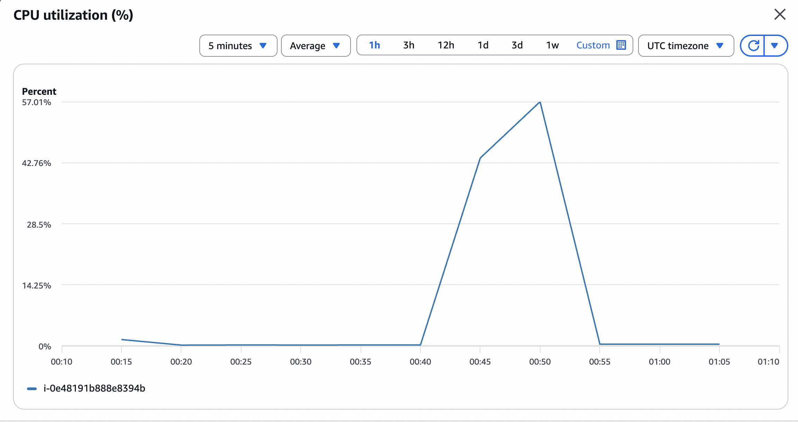

# Week 06 — Load Test Report

## Objective

The goal of this lab was to test how AWS Auto Scaling works when an EC2 instance is terminated or when CPU usage increases.

## Test Environment

- **Region:** us-east-1
- **Operating System:** Amazon Linux 2023
- **Instance Type:** t3.micro
- **Auto Scaling Group:** `training-asg`
- **Load Balancer:** `training-alb`
- **Scaling Policy:** Target Tracking (50% average CPU)
- **Initial Desired Capacity:** 2 instances
- **Minimum Capacity:** 1 instance
- **Maximum Capacity:** 4 instances

## Part A — Self-Healing Test

I manually terminated one EC2 instance to see if the Auto Scaling Group would replace it.

I checked the ASG Activity History to see when AWS launched a new instance.


## Part B — CPU Stress Test

I installed `stress` on an EC2 instance running Amazon Linux 2023.

I ran these commands:

```bash
sudo dnf install -y stress
stress --cpu 2 --timeout 300
```

The test increased CPU usage for five minutes.

### CloudWatch CPU Monitoring

I used CloudWatch to monitor CPU usage before, during, and after the test.

I observed the following results:

- Before the test, CPU usage was around 0–2%.
- During the test, CPU usage increased to **57.01%** (five-minute average).
- The CPU spike appeared around **00:45–00:50 UTC on November 2, 2026** (4:45–4:50 PM PST on November 1).
- After the test, CPU usage dropped back to a low level.



### Auto Scaling Activity

I checked the ASG Activity History and CloudWatch alarms.

I found that AWS automatically reduced the number of EC2 instances from 2 to 1 when CPU usage was low. This is called Scale In.

I also checked the High CPU Alarm. It was set to trigger when the ASG's average CPU usage stayed above 50% for three consecutive one-minute periods.

Although CPU usage reached 57.01% during the test, I did not observe an automatic Scale Out event.

### Timestamp Comparison

| Event | Time (UTC) |
|---|---|
| CPU spike | Around 00:45–00:50, November 2, 2026 |
| Automatic Scale Out | Not observed |
| Time difference | N/A |


## Conclusion

In this lab, I learned how AWS Auto Scaling helps manage EC2 instances.

I tested self-healing by terminating an instance and observing the replacement process.

I also used a CPU stress test and saw CPU usage increase to 57.01% in CloudWatch.

AWS automatically scaled in when CPU usage was low, but I did not observe an automatic scale-out event during my test.

